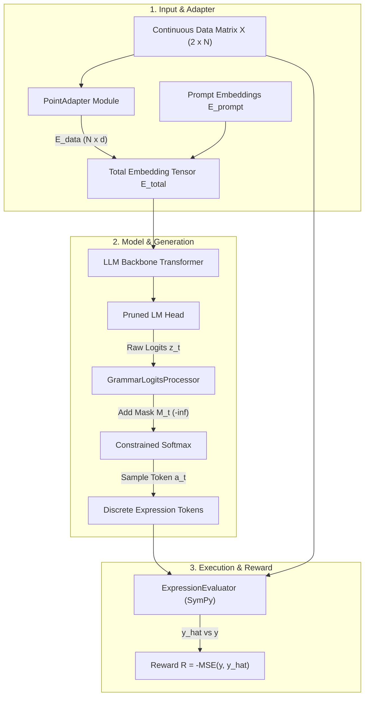

# Experiment 01: Continuous-to-Discrete Symbolic Regression

## Theoretical Introduction
This experiment tests the viability of mapping a continuous 2D point cloud directly to an analytic mathematical equation $y = f(x)$ using an RL-optimized language model.

We'll assume the expressions come from the following grammar:

```ebnf
(* EBNF Grammar for Single-Variable Mathematical Expressions *)

expression = term , { ( "+" | "-" ) , term } ;
term       = factor , { ( "*" | "/" ) , factor } ;
factor     = primary , [ "^" , primary ] ;

primary    = [ "-" ] , atom ;
atom       = variable | number | function_call | "(" , expression , ")" ;

function_call = function_name , "(" , expression , ")" ;
function_name = "sin" | "cos" | "tan" | "exp" | "log" | "sqrt" | "abs" ;

variable   = "x" ;
number     = constant | float | integer ;
constant   = "pi" | "e" ;
integer    = [ "-" ] , digit , { digit } ;
float      = [ "-" ] , digit , { digit } , "." , digit , { digit } ;
digit      = "0" | "1" | "2" | "3" | "4" | "5" | "6" | "7" | "8" | "9" ;
```

### Data and Input Formulation

We define a dataset consisting of pairs of continuous coordinate tensors and their corresponding discrete expressions. So, each example in the dataset consists of an expression $E_k$, a set of sampled inputs $x_{kj}$, $j=1...N$, and the corresponding outputs $y_{kj} = E_k(x_{kj})$. The inputs and outputs are represented together as a matrix $\mathbf{X}_k \in \mathbb{R}^{2 \times N}$ where the first row corresponds to the independent variable $x$ and the second row corresponds to the dependent variable $y$.

### Input Representation

We introduce a continuous adapter module to map the continuous input data to the discrete token embedding space of the LLM. Let $\mathbf{X}_k \in \mathbb{R}^{2 \times N}$ be the input matrix representing the coordinates. The adapter consists of a two-layer linear network that transforms this 2D representation into a sequence of tokens of length $N$. This sequence is then projected into the LLM's embedding dimension $d$ and concatenated to the prompt embeddings.

$$
\mathbf{E}_{total} = \mathbf{E}_{prompt} || \text{Linear}_2(\text{ReLU}(\mathbf{X} \mathbf{W}_{proj} + \mathbf{b}_{proj}))
$$

Where $\mathbf{W}_{proj} \in \mathbb{R}^{2 \times d}$. This is concatenated with the text embeddings of the system prompt to form the full input sequence.

### Constrained Policy Generation

The generation process proceeds autoregressively, mapping the combined prompt and data embeddings $\mathbf{E}_{total}$ to a syntactically valid sequence of discrete mathematical tokens $a_0, a_1, \dots, a_{T-1} \in \mathcal{V}_{math}$.

#### Input Sequence Assembly & Embedding Context
Let $\mathbf{E}_{prompt} \in \mathbb{R}^{L_{prompt} \times d}$ be the standard text token embeddings of the system prompt, and $\mathbf{E}_{data} \in \mathbb{R}^{N \times d}$ be the continuous adapter outputs. The total sequence embedding tensor at step $t=0$ is formed by sequence concatenation:

$$
\mathbf{E}^{(0)} = \mathbf{E}_{total} = \mathbf{E}_{prompt} \parallel \mathbf{E}_{data} \in \mathbb{R}^{(L_{prompt} + N) \times d}
$$

At generation step $t \ge 0$, given previous generated tokens $a_{<t} = (a_0, \dots, a_{t-1})$ with token embeddings $\mathbf{E}_{gen, <t} \in \mathbb{R}^{t \times d}$, the full context sequence is:

$$
\mathbf{S}_t = \mathbf{E}_{total} \parallel \mathbf{E}_{gen, <t} \in \mathbb{R}^{(L_{prompt} + N + t) \times d}
$$

#### Transformer Forward Pass
The context sequence $\mathbf{S}_t$ passes through the $L$-layer Transformer autoregressive backbone to compute hidden states across all sequence positions:

$$
\mathbf{H}_t = \text{Transformer}(\mathbf{S}_t) \in \mathbb{R}^{(L_{prompt} + N + t) \times d}
$$

The final hidden representation vector corresponding to the last position sequence index is extracted:

$$
\mathbf{h}_t = \mathbf{H}_t[-1, :] \in \mathbb{R}^d
$$

#### Logit Projection
The hidden vector $\mathbf{h}_t$ is projected through the LM output projection matrix $\mathbf{W}_{head} \in \mathbb{R}^{d \times |\mathcal{V}_{math}|}$ mapped to the targeted mathematical vocabulary $\mathcal{V}_{math}$ to produce unnormalized raw logit scores:

$$
\mathbf{z}_t = \mathbf{h}_t \mathbf{W}_{head} + \mathbf{b}_{head} \in \mathbb{R}^{|\mathcal{V}_{math}|}
$$

#### Grammar State Machine & Logit Masking
To guarantee 100% syntactic validity, a deterministic pushdown state machine evaluates the generated history state $s_t = a_{<t}$ under the formal context-free grammar. It computes the subset of grammatically valid next tokens $\mathcal{V}_{valid}(s_t) \subseteq \mathcal{V}_{math}$ and constructs an additive masking vector $\mathbf{M}_t \in \mathbb{R}^{|\mathcal{V}_{math}|}$:

$$
M(a_t, s_t) = \begin{cases} 
0 & \text{if } a_t \in \mathcal{V}_{valid}(s_t) \\ 
-\infty & \text{if } a_t \notin \mathcal{V}_{valid}(s_t) 
\end{cases}
$$

#### Constrained Policy & Sampling
The additive mask $\mathbf{M}_t$ is applied to the raw logits prior to computing the softmax distribution over the vocabulary:

$$
\pi_\theta(a_t|s_t) = \frac{\exp(z_t(a_t) + M(a_t, s_t))}{\sum_{a' \in \mathcal{V}_{math}} \exp(z_t(a') + M(a', s_t))}
$$

The next token $a_t \sim \pi_\theta(\cdot | s_t)$ is sampled from this constrained distribution, appended to the generation sequence $a_{<t+1} = (a_{<t}, a_t)$, and fed into step $t+1$ until an end-of-expression token or maximum generation length is reached.

### Reward Formulation
The discrete expression sequence generated by the policy is evaluated against the $x$ components of the input point cloud to yield predictions $\hat{y}$. The reward $R$ is formulated as the negative Mean Squared Error:

$$
R = - \frac{1}{N} \sum_{i=1}^{N} (y_i - \hat{y}_i)^2
$$

### PPO Objective Function
The objective function of PPO takes the expectation operator, which means that this function will be computed over quantities of trajectories. The expectation operator takes the minimum of two terms. We maximize the clipped surrogate objective:

$$
L^{CLIP}(\theta) = \hat{\mathbb{E}}_t \left[ \min(r_t(\theta)\hat{A}_t, \text{clip}(r_t(\theta), 1-\epsilon, 1+\epsilon)\hat{A}_t) \right]
$$

Where $r_t(\theta)$ is the probability ratio between the updated policy and the old policy. The function clip restricts the value of the probability ratio within the interval $[1-\epsilon, 1+\epsilon]$. $\hat{A}_t$ is the estimated advantage. 

## Technical Implementation Description

To translate the mathematical model directly into executable code, the system is architected into five core components:



---

### Continuous Adapter Module (`PointAdapter`)

- **Class Definition:** `class PointAdapter(nn.Module)`
- **Input Shape:** Tensors $\mathbf{X} \in \mathbb{R}^{B \times 2 \times N}$, where index 0 is feature $x$ and index 1 is target $y$.
- **Architecture:**
  ```python
  self.proj1 = nn.Linear(2, d_hidden)
  self.activation = nn.ReLU()
  self.proj2 = nn.Linear(d_hidden, d_model)
  ```
- **Forward Pass:** 
  1. Transpose input coordinates to $\mathbb{R}^{B \times N \times 2}$.
  2. Compute $\mathbf{E}_{data} = \text{proj2}(\text{ReLU}(\text{proj1}(\mathbf{X}^{T}))) \in \mathbb{R}^{B \times N \times d_{model}}$.
- **Concatenation:** In `forward_with_adapter()`, system prompt embeddings $\mathbf{E}_{prompt} \in \mathbb{R}^{B \times L_{prompt} \times d_{model}}$ are prepended along dimension 1:
  $$\mathbf{E}_{total} = \text{torch.cat}([\mathbf{E}_{prompt}, \mathbf{E}_{data}], \text{dim}=1)$$

---

### Surgical Vocabulary Pruning (`VocabScalpel`)

- **Vocabulary Mapping:** A strict math vocabulary $\mathcal{V}_{math}$ containing 30–50 specific tokens (`x`, `+`, `-`, `*`, `/`, `^`, `sin`, `cos`, `exp`, `log`, `sqrt`, `abs`, `(`, `)`, digits `0-9`, `.`, `<EOS>`).
- **Index Translation:** Create a bidirectional map `token_to_math_id` and `math_id_to_token`.
- **Weight Matrix Slicing:**
  ```python
  new_embed = nn.Embedding(len(math_vocab), d_model)
  new_head = nn.Linear(d_model, len(math_vocab), bias=False)
  # Extract slice of pre-trained weights corresponding to math tokens
  new_embed.weight.data = base_model.embed_tokens.weight.data[math_token_ids]
  new_head.weight.data = base_model.lm_head.weight.data[math_token_ids]
  ```
- **Benefit:** Reduces vocabulary memory footprint and logit computation overhead by $>99\%$ (from ~150k tokens down to ~40 tokens).

---

### Grammar State Machine & Logits Processor (`GrammarLogitsProcessor`)

- **Class Definition:** Inherits from `transformers.LogitsProcessor`.
- **State Representation:** State $s_t$ is tracked via a deterministic pushdown automaton:
  - `stack`: Tracks structural hierarchy (open parentheses `(`, active function calls like `sin(`).
  - `last_token_type`: Categorized as `OPERAND` ($x$, constant, digit), `BINARY_OPERATOR` ($+,-,*,/,^\wedge$), `UNARY_FUNCTION` ($\sin, \cos, \dots$), `OPEN_PAREN`, `CLOSE_PAREN`.
- **State Transition & Validation Rules:**
  - *After `START` or `BINARY_OPERATOR` or `OPEN_PAREN`:* Only `OPERAND`, `UNARY_FUNCTION`, or `OPEN_PAREN` are valid.
  - *After `OPERAND` or `CLOSE_PAREN`:* Only `BINARY_OPERATOR`, `CLOSE_PAREN` (if `stack` non-empty), or `<EOS>` (if parentheses balanced and expression non-trivial) are valid.
- **Mask Construction (`__call__(input_ids, scores)`):**
  1. For each batch element, inspect generated history $a_{<t}$.
  2. Compute allowed token ID set $\mathcal{V}_{valid}(s_t) \subseteq \mathcal{V}_{math}$.
  3. Set `scores[b, token_id] = -float('inf')` for all `token_id` $\notin \mathcal{V}_{valid}(s_t)$.

---

### Expression Evaluator & Reward Engine (`ExpressionEvaluator`)

- **String Parsing:** Reconstruct discrete expression string $e = \text{decode}(a_0, \dots, a_{T-1})$.
- **Safe Execution Pipeline:**
  1. **AST Construction:** Parse $e$ with `sympy.parse_expr` using restricted local symbol definitions $\{x: \text{Symbol('x')}\}$.
  2. **Numerical Vectorization:** Convert AST to a NumPy vectorized function via `sympy.lambdify(x, ast, modules=['numpy'])`.
  3. **Evaluation & Safety Safeguards:**
     ```python
     try:
         y_hat = vectorized_fn(x_eval)
         if np.any(np.isnan(y_hat)) or np.any(np.isinf(y_hat)):
             reward = -100.0  # Penalty for non-finite evaluations
         else:
             mse = np.mean((y_eval - y_hat) ** 2)
             reward = -float(mse)
     except Exception:
         reward = -100.0  # Penalty for parsing/runtime execution error
     ```

---

### Reinforcement Learning Orchestration (`PPOTrainer`)

- **Policy Model:** Backbone transformer wrapped with QLoRA (`peft.LoraConfig`) applied to self-attention target modules (`q_proj`, `v_proj`).
- **Trainable Parameters:** `PointAdapter` weights + QLoRA adapters. Backbone model weights remain frozen.
- **Rollout Step:**
  1. Sample batch of point clouds $\mathbf{X}_k \in \mathbb{R}^{2 \times N}$.
  2. Compute continuous embeddings $\mathbf{E}_{total}$ and feed into generator with `GrammarLogitsProcessor`.
  3. Sample token sequences $a_{0:T-1} \sim \pi_\theta(\cdot | \mathbf{E}_{total})$.
  4. Compute rewards $R = -\text{MSE}(y, \hat{y})$ for each generated sequence.
  5. Perform PPO step via `trl.PPOTrainer.step(queries, responses, rewards)` to update LoRA and Adapter parameters.

---

### Success Criteria
*   **Syntactic Validity:** 100% of generated outputs must be executable mathematical expressions without triggering parsing errors.
*   **Loss Convergence:** The PPO training loop must demonstrate a monotonic decrease in MSE on a static batch before generalizing to the broader dataset.
*   **Inference Retention:** After applying the Wanda pruning pass, the model must achieve $\ge 50\%$ sparsity with less than a 5% degradation in the evaluation MSE.

## Task Breakdown & Execution Plan
The development cycle is optimized for highly focused, one-to-two-hour weekly sprints. Core PyTorch logic is written and verified locally. Heavy compute tasks are pushed to remote RunPod GPUs using SkyPilot.

### Phase 0: Infrastructure Scaffolding (Week 1)
*   **Task 1 (Local Setup):** Initialize the repository using `uv init`. Add required dependencies (`torch`, `transformers`, `peft`, `trl`, `wandb`, `sympy`) via `pyproject.toml` to ensure instantaneous locking and virtual environment setup.
    *   *Acceptance Criteria:* `pyproject.toml` contains locked project dependencies; `uv sync` initializes a clean, functional virtualenv without version conflicts.
*   **Task 2 (Cloud Orchestration):** Create a `task.yaml` file for SkyPilot to automate RunPod GPU provisioning. Set the launch command to synchronize the local `uv` environment on the remote instance.
    *   *Acceptance Criteria:* `task.yaml` validates against SkyPilot schema; `sky check` confirms cloud provider readiness; SkyPilot successfully provisions a GPU instance and syncs the codebase.
*   **Task 3 (Telemetry & Execution Bridge):** Write a `scripts/sanity_check.py` script. Execute it locally and remotely via `sky launch` to verify GPU detection, tensor ops, and Weights & Biases telemetry logging.
    *   *Acceptance Criteria:* `scripts/sanity_check.py` executes cleanly both locally (`--offline`) and on remote RunPod GPU, logging hardware metrics and dummy loss to the `wandb` dashboard.

### Phase 1: The Local Sandbox (Weeks 2–4)
*   **Task 4 (Synthetic Ground Truth):** Write a Python script using `sympy` to procedurally generate valid mathematical ASTs and their associated 2D point clouds.
    *   *Acceptance Criteria:* Procedural generator outputs $\ge 100\text{k}$ valid expressions under the EBNF grammar; evaluates continuous point clouds $\mathbf{X} \in \mathbb{R}^{2 \times N}$ without NaN/Inf values; saves dataset in parquet/h5 format.
*   **Task 5 (The Grammar Mask):** Build a custom Hugging Face `LogitsProcessor`. Implement the pushdown state machine to force illegal token logits to $-\infty$ based on the allowed grammar subset.
    *   *Acceptance Criteria:* Unit test suite achieves 100% state machine validation accuracy; illegal next-token logits are set to $-\infty$; zero parsing errors triggered across 1,000 autoregressive rollouts.
*   **Task 6 (Continuous Adapter):** Implement the `PointAdapter` PyTorch linear projection module. Write a local mock to ensure `[batch_size, 2, num_points]` tensors correctly project to $\mathbb{R}^{B \times N \times d_{model}}$ and concatenate with text embeddings.
    *   *Acceptance Criteria:* `PointAdapter` forward pass computes output shape `[B, N, d_model]`; concatenation with `E_prompt` along dimension 1 produces `E_total` matching sequence length $L_{prompt} + N$; gradient propagation through adapter layers verified via unit test.

### Phase 2: The Surgical Bay (Weeks 5–6)
*   **Task 7 (Vocabulary Scalpel):** Write an isolation script to load a base model (e.g., Qwen-1.5B), slice the embedding and head matrices down to the 30-50 required math tokens, and save the compressed configuration locally.
    *   *Acceptance Criteria:* Pruning script extracts `embed_tokens` and `lm_head` weights for math tokens $|\mathcal{V}_{math}| \approx 40$; saves model checkpoint with disk footprint $<100\text{MB}$; preserves original pretrained embedding vectors for math symbols.
*   **Task 8 (Forward Pass Mock):** Feed a dummy point cloud through the `PointAdapter` into the surgically pruned model. Verify that the output logits exactly match the tiny vocabulary size without shape mismatch errors.
    *   *Acceptance Criteria:* Mock script feeds point cloud embeddings into sliced model backbone; output logit tensor has shape `[B, L_total, |V_math|]`; backward pass completes without dimension mismatch or CUDA memory error.

### Phase 3: The RL Training Loop (Weeks 7–9)
*   **Task 9 (Reward Function):** Write the `ExpressionEvaluator` module. It must safely parse generated token sequences into SymPy ASTs, evaluate against target $x$ points, and return $-MSE$ as a scalar.
    *   *Acceptance Criteria:* `ExpressionEvaluator` parses token strings, evaluates ASTs via NumPy vectorization, and returns $-MSE$; returns penalty reward $-100.0$ on execution error, timeout, or non-finite output; executes batch evaluation in $<50\text{ms}$.
*   **Task 10 (First PPO Rollout):** Integrate the custom model, `LogitsProcessor`, and Reward function into `trl.PPOTrainer`. Wrap the model using QLoRA. Use SkyPilot to trigger a 5-minute training run on RunPod GPU.
    *   *Acceptance Criteria:* 5-minute remote PPO rollout run executes on RunPod GPU; `PPOTrainer` computes policy and value losses; backpropagation updates QLoRA and `PointAdapter` parameters without numerical divergence or NaNs.
*   **Task 11 (Full Training Run):** Scale the batch size. Trigger a long-running execution on RunPod and monitor the convergence metrics via the `wandb` dashboard.
    *   *Acceptance Criteria:* Training run converges over full dataset; WandB logs show monotonic decrease in evaluation MSE and increase in average rollout reward; trained model correctly reconstructs target benchmark functions (e.g., $y = \sin(x)$, $y = 2x^2 + 1$).

### Phase 4: Post-Processing & The Paper (Weeks 10–12)
*   **Task 12 (Wanda Pruning):** Execute a post-training compression script on the tuned model. Apply Wanda to prune weights based on the product of weight magnitudes and input activation norms.
    *   *Acceptance Criteria:* Post-training pruning script achieves $\ge 50\%$ weight sparsity on fine-tuned model weights; evaluation MSE degrades by $\le 5\%$ relative to the unpruned baseline.
*   **Task 13 (Evaluation & Metrics):** Run a zero-shot evaluation on a withheld test set of point clouds. Generate comparative plots for inference speed and MSE.
    *   *Acceptance Criteria:* Evaluation suite measures dense vs. pruned model performance on 1,000 withheld test functions; logs token latency, MSE distributions, and exact expression recovery rates; generates comparative plots for paper figures.
*   **Task 14 (Manuscript):** Draft the core research paper based on the generated plots, focusing heavily on the continuous-to-discrete translation methodology.
    *   *Acceptance Criteria:* Complete research manuscript draft covering abstract, theoretical formulation, architecture diagrams, training curves, pruning ablation tables, and qualitative symbolic recovery examples.